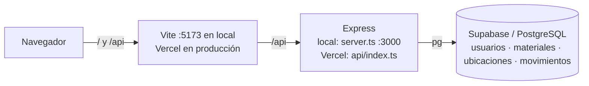
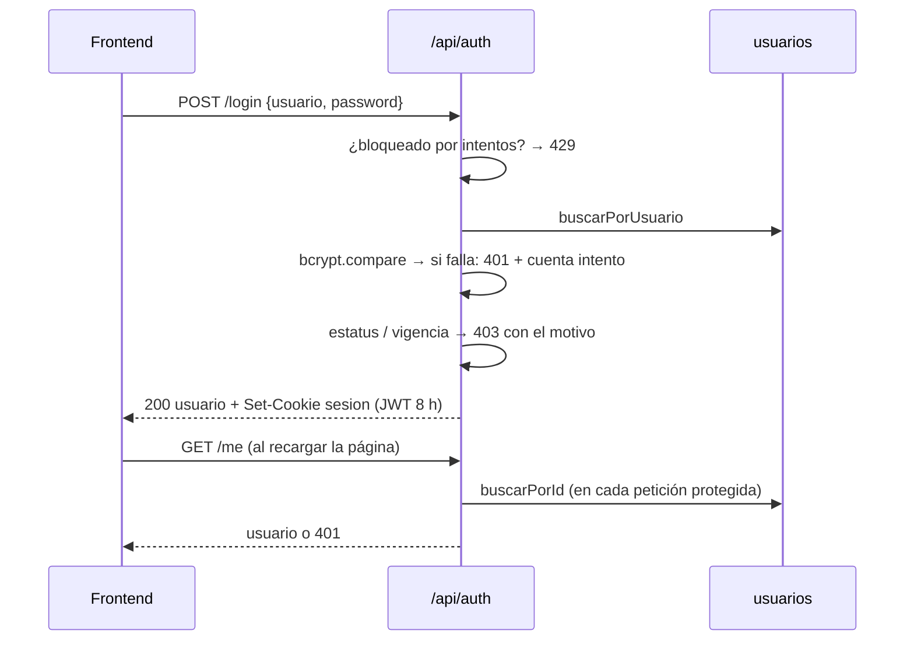

# Sistema Grupo Armas — Documentación técnica

> Estado al 18/11/2026. Dirigida al equipo técnico que continúe el desarrollo.

## 1. Resumen

Aplicación web interna para **consultar el inventario de piezas por planta y dar seguimiento a los traspasos de material entre plantas** de Grupo Armas (plantas 1, 2, 3 y 6).

| Área | Estado |
| --- | --- |
| Login, sesión y permisos | Implementado (backend + frontend) |
| Control de usuarios (CRUD) | Implementado sobre PostgreSQL / Supabase |
| Inventario, seguimiento entre plantas, historial | Implementado sobre PostgreSQL / Supabase, con **datos de prueba** (§4.3) |
| Captura de movimientos | Endpoint con validaciones listo (`POST /api/inventario/movimientos`); **falta la pantalla** |
| Pruebas automatizadas | Sin empezar |
| Despliegue | Vercel (frontend estático + API como función serverless), ver §3.1 |

## 2. Arquitectura



- La app de Express vive en `backend/src/app.ts` (sin `listen`). En local la arranca `server.ts`; en Vercel la exporta `api/index.ts` como función serverless.
- En desarrollo, Vite reenvía `/api/*` a `http://localhost:3000` (`frontend/vite.config.ts`); en Vercel, `vercel.json` reescribe `/api/*` a la función. En ambos casos frontend y API quedan en el mismo origen, por eso **no se usa CORS** y la cookie de sesión funciona con `SameSite=Strict`.
- `JWT_SECRET` y `DATABASE_URL` son obligatorias: sin ellas el backend no arranca. **Los usuarios siempre son los reales de Supabase**; inventario y movimientos usan datos de prueba a propósito (§4.3).

### Stack

| Capa | Tecnología |
| --- | --- |
| Frontend | React 19, TypeScript, Vite 8, React Compiler, `react-day-picker` + `date-fns` |
| Backend | Node 24, Express 5, TypeScript, `tsx` en desarrollo |
| Base de datos | PostgreSQL alojado en Supabase (`pg`) |
| Seguridad | `bcryptjs` (hash de contraseñas), `jsonwebtoken` (sesión), `cookie-parser` |

### Estructura de carpetas

```
ProyectoEstadias/
├── api/index.ts                 # función serverless de Vercel (exporta backend/src/app.ts)
├── vercel.json                  # build, rewrites /api, región y encabezados de seguridad
├── tsconfig.json                # solo para api/ (lo usa Vercel al compilar la función)
├── backend/
│   ├── sql/                     # respaldo del esquema (01, 03) y migraciones a ejecutar a mano (04, 05)
│   │   ├── 01_usuarios.sql      # tabla usuarios
│   │   ├── 03_inventario.sql    # materiales, ubicaciones, movimientos y vistas
│   │   ├── 04_sesiones.sql      # columna sesion_version (revocación de sesiones)
│   │   └── 05_rol_app.sql       # rol app_inventario de mínimo privilegio
│   └── src/
│       ├── app.ts               # app de Express: middlewares, rutas, 404 y errores
│       ├── server.ts            # arranque local (listen solo en 127.0.0.1)
│       ├── config/env.ts        # requiredEnv(): falla si falta una variable
│       ├── config/tiempo.ts     # "hoy" y "ahora" en la zona del negocio (APP_TIMEZONE)
│       ├── auth/
│       │   ├── session.ts       # JWT con versión, cookie, HTTPS, regla de estatus/vigencia
│       │   ├── middleware.ts    # requireAuth, requireAdmin, requireRoles
│       │   └── loginAttempts.ts # bloqueo por intentos fallidos (memoria)
│       ├── db/
│       │   ├── usersRepository.ts          # tipos + interfaz UsersRepository
│       │   ├── postgresUsersRepository.ts  # implementación PostgreSQL
│       │   ├── inventarioRepository.ts     # inventario, movimientos y sus reglas
│       │   ├── pool.ts                     # pool de conexiones pg
│       │   └── index.ts                    # crea el repositorio de usuarios
│       ├── routes/
│       │   ├── auth.ts          # /api/auth
│       │   ├── users.ts         # /api/users
│       │   └── inventario.ts    # /api/inventario
│       ├── validation/
│       │   ├── users.ts         # validación y normalización de usuarios
│       │   └── movimientos.ts   # validación de un movimiento nuevo
│       └── scripts/crearAdmin.ts
├── frontend/
│   └── src/
│       ├── App.tsx              # pantallas y navegación
│       ├── api/                 # client.ts, auth.ts, users.ts, inventario.ts
│       ├── components/users/UsersScreen.tsx
│       ├── components/filters/  # filtros por fecha y material
│       ├── hooks/               # useTableFilters.ts, useRemoteData.ts (carga desde la API)
│       ├── lib/              # dates.ts, exportExcel.ts
│       └── types/               # user.ts, inventario.ts
└── docs/DOCUMENTACION.md
```

## 3. Puesta en marcha

### Requisitos

- Node.js 24 o superior (probado con 24.14).
- El proyecto de Supabase (ya tiene el esquema y los datos).

### Variables de entorno (`backend/.env`)

Copiar `backend/.env.example` a `backend/.env` y llenar:

| Variable | Obligatoria | Uso |
| --- | --- | --- |
| `PORT` | No (3000) | Puerto del backend. Si se cambia, ajustar el proxy de `vite.config.ts`. |
| `JWT_SECRET` | **Sí** | Firma de las sesiones. Sin ella el servidor no arranca. Generar con `node -e "console.log(require('crypto').randomBytes(48).toString('hex'))"`. Usar uno distinto por ambiente. |
| `DATABASE_URL` | **Sí** | Cadena de conexión a Supabase con el rol `app_inventario` (§4.4). Sin ella el servidor no arranca. |
| `DATABASE_CA_CERT` | **Sí en Vercel** | Certificado raíz de Supabase (PEM). Con él la conexión verifica el certificado del servidor (CA y nombre del host). En Vercel, sin él la API no arranca; en local solo muestra un aviso. |
| `HOST` | No (`127.0.0.1`) | Interfaz donde escucha el backend local. Por defecto solo esta máquina: la red entra por el HTTPS de Vite (§3.2). |
| `APP_TIMEZONE` | No (`America/Mexico_City`) | Zona para "hoy" (vigencias) y "ahora" (fechas futuras). Vercel corre en UTC, por eso no se usa la hora del sistema. |
| `PGHOST`, `PGPORT`, `PGUSER`, `PGPASSWORD`, `PGDATABASE` | No | Alternativa a `DATABASE_URL`; solo se leen si ésta está vacía. |

En el frontend, `VITE_API_URL` es opcional (por defecto `/api`).

**Cadena de Supabase:** Dashboard → botón **Connect** → **Connection String** → método **Transaction pooler** (puerto 6543; es el indicado para Vercel, donde cada función abre conexiones cortas). Cambiar el usuario `postgres.<proyecto>` por `app_inventario.<proyecto>` (§4.4); no hace falta agregar parámetros `ssl*`: el cifrado y la verificación los da `DATABASE_CA_CERT` (*Project Settings → Database → SSL Configuration → Download certificate*). La contraseña es la de la **base de datos**, no la de la cuenta; se cambia en *Project Settings → Database → Reset database password*. Caracteres especiales en la contraseña deben ir codificados en URL (`@` → `%40`).

### Primera vez

```bash
# 1. Dependencias
cd backend && npm install
cd ../frontend && npm install

# 2. (Solo si se perdió el acceso) crear o recuperar un administrador
cd backend
npm run crear-admin -- USUARIO CONTRASEÑA
```

El esquema y los datos ya están en Supabase. `backend/sql/` es el respaldo del esquema por si hubiera que recrear la BD (en orden: `01`, `03`, `04`, `05`).

**Migraciones pendientes en una BD existente** (SQL Editor de Supabase, una sola vez y antes de desplegar este backend):
1. `04_sesiones.sql`: columna `sesion_version` (revocación de sesiones, §5).
2. `05_rol_app.sql`: rol `app_inventario` de mínimo privilegio (§4.4). Después, en otra consulta: `ALTER ROLE app_inventario PASSWORD '<contraseña larga y aleatoria>';` y actualizar `DATABASE_URL` en `.env` y en Vercel.

### Comandos

| Dónde | Comando | Qué hace |
| --- | --- | --- |
| backend | `npm run dev` | Servidor con recarga automática (`tsx watch`) |
| backend | `npm run build` / `npm start` | Compila a `dist/` y lo ejecuta |
| backend | `npm run crear-admin -- USUARIO CONTRASEÑA` | Crea un ADMINISTRADOR o convierte uno existente en admin activo con contraseña nueva |
| frontend | `npm run dev` | Vite en `http://localhost:5173` (o `https://<IP>:5173` en la red local, §3.2) |
| frontend | `npm run build` | Chequeo de tipos + build de producción |
| frontend | `npm run lint` | ESLint |

### 3.1 Despliegue en Vercel

Un solo proyecto de Vercel sirve el frontend (estático) y la API (función serverless) en el mismo dominio. Todo está en `vercel.json`:

- **Install:** `npm ci` en `backend/` y `frontend/`.
- **Build:** `tsc` del backend (si hay errores de tipos, el deploy falla) y `vite build` del frontend → `frontend/dist`.
- **API:** `/api/*` se reescribe a `api/index.ts`, que exporta la app de Express.
- **Región:** `pdx1` (Oregón), la misma zona de AWS que Supabase (`us-west-2`), para que cada consulta tarde lo mínimo.
- **Encabezados:** `Content-Security-Policy` (solo recursos del mismo origen, sin scripts en línea; por eso el script del tema está en `frontend/public/tema.js`), `nosniff`, `X-Frame-Options: DENY`, HSTS y `Cache-Control: no-store` en la API.

Pasos (una sola vez):

1. En Vercel: **Add New → Project**, importar el repositorio de GitHub. **Root Directory: la raíz del repo** (no `frontend/` ni `backend/`). El *Framework Preset* se deja en *Other*: `vercel.json` ya define todo.
2. En **Settings → Environment Variables** (Production y Preview):
   - `JWT_SECRET`: uno **nuevo**, distinto al de desarrollo.
   - `DATABASE_URL`: la cadena del *Transaction pooler* con el usuario `app_inventario.<proyecto>` (ver arriba).
   - `DATABASE_CA_CERT`: el contenido del certificado de Supabase (se puede pegar multilínea).
   - Opcional: `APP_TIMEZONE`.
3. **Deploy.** Cada push a `main` vuelve a desplegar; las ramas generan *Preview deployments* (usan la misma BD).

Comprobar después del deploy: `https://<dominio>/api/auth/me` debe responder `401` en JSON; si responde `500`, revisar en **Logs** de Vercel que las variables estén configuradas.

Para probar el build de Vercel en local: `npx vercel dev` (requiere `vercel link`).

### 3.2 Uso en red local

Sin configuración extra, Vite y el backend solo responden en esta máquina (`localhost`). Para que otras computadoras de la red entren, Vite debe servir por **HTTPS**: así la contraseña y la cookie de sesión no viajan en texto plano. El backend además rechaza con 403 cualquier petición por HTTP que no venga de esta misma máquina.

1. Instalar [mkcert](https://github.com/FiloSottile/mkcert) y generar el certificado en `frontend/certs/` (ignorada por git; contiene una llave privada):
   ```bash
   mkcert -install
   mkdir -p frontend/certs
   mkcert -cert-file frontend/certs/servidor.pem -key-file frontend/certs/servidor-key.pem <hostname> <IP> localhost
   ```
2. Copiar `frontend/.env.example` a `frontend/.env.local` y descomentar `DEV_HTTPS_CERT` y `DEV_HTTPS_KEY`.
3. `npm run dev` en `frontend/`: ahora escucha en la red en `https://<IP>:5173`.
4. En cada computadora cliente, instalar la CA de mkcert (`mkcert -CAROOT` muestra dónde está `rootCA.pem`) para que el navegador no muestre advertencias. Nunca compartir `rootCA-key.pem`.

## 4. Base de datos

### 4.1 Tabla `usuarios`

Definida en `backend/sql/01_usuarios.sql`.

| Columna | Tipo | Reglas |
| --- | --- | --- |
| `id` | `SERIAL` | PK |
| `usuario` | `VARCHAR(30)` | `NOT NULL UNIQUE`. Se guarda en mayúsculas. |
| `password_hash` | `VARCHAR(100)` | Hash bcrypt (10 rondas). Nunca sale de la API. |
| `tipo_usuario` | `VARCHAR(20)` | `ADMINISTRADOR`, `CAPTURISTA` o `CONSULTA` |
| `vigencia_fini` | `DATE` | Inicio de vigencia; `NULL` = sin límite |
| `vigencia_fechafin` | `DATE` | Fin de vigencia; `NULL` = sin límite |
| `estatus` | `VARCHAR(10)` | `ACTIVO` (default) o `INACTIVO` |
| `sesion_version` | `INTEGER` | Versión de sesión (default 0); se incrementa al cerrar sesión o cambiar la contraseña |

RLS activo; la única política es para el rol del backend `app_inventario` (§4.4). La API pública de Supabase no la ve.

### 4.2 Repositorio

Todo acceso a usuarios pasa por la interfaz `UsersRepository` (`listar`, `buscarPorId`, `buscarPorUsuario`, `buscarSesion`, `cerrarSesiones`, `crear`, `modificar`, `eliminar`, `existeUsuario`), implementada por `PostgresUsersRepository`. Los usuarios son **reales**: no hay usuarios de ejemplo.

### 4.3 Inventario y movimientos

Definido en `backend/sql/03_inventario.sql`. Igual que `usuarios`, las tablas tienen RLS activo con políticas solo para el rol del backend (§4.4); la API pública de Supabase no ve nada (las vistas usan `security_invoker`).

| Tabla | Contenido | Reglas principales |
| --- | --- | --- |
| `materiales` | `id` (bigint identity), `sku` `VARCHAR(30)`, `nombre` `VARCHAR(120)`, `estatus` booleano (true = activo) | SKU único y no vacío; nombre obligatorio |
| `ubicaciones` | `id`, `nombre`, `tipo`, `estatus` | Nombre único. `tipo`: `PLANTA` (Planta 1, 2, 3, 6), `PROVEEDOR` (solo origen) o `CONSUMO` (solo destino) |
| `movimientos` | `fecha` (timestamp, hasta el minuto), `material_id`, `lote`, `origen_id`/`origen_tipo`, `destino_id`/`destino_tipo`, `cantidad`, `usuario_id` (quién capturó), `creado_en` | Cantidad > 0; origen ≠ destino; un lado debe ser planta; el tipo guardado debe coincidir con la ubicación (llave foránea compuesta) |

Cada movimiento se captura **una sola vez**:

| Origen → Destino | Efecto |
| --- | --- |
| Proveedor → Planta | Entrada: suma en la planta destino |
| Planta → Planta | Traspaso: resta en origen, suma en destino |
| Planta → Consumo | Salida: resta en la planta de origen |

Vistas:

- `v_movimientos`: movimientos con SKU y nombres de origen/destino. La tabla de cada planta es `WHERE origen = 'Planta X' OR destino = 'Planta X'`.
- `v_inventario`: existencia por material y planta (destino suma, origen resta). **El inventario no se guarda**: se calcula siempre de los movimientos.

Reglas que valida el backend al registrar (`InventarioRepository.registrarMovimiento`), porque la BD sola no puede:

- Material, origen y destino existentes y **activos**.
- Si sale de una planta, **el lote debe tener existencia suficiente en esa planta**, y la existencia del lote no puede quedar negativa en ningún momento de su historia (impide capturar con fecha anterior una salida que no tenía material).
- Las salidas del mismo lote desde la misma planta se serializan (`pg_advisory_xact_lock`): dos capturas simultáneas no pueden gastar la misma existencia.
- Fecha obligatoria, real y no futura; lote obligatorio (se guarda en mayúsculas, máx. 30); cantidad entera entre 1 y 1,000,000.

Una planta inactiva deja de aparecer como columna del inventario, salvo que todavía tenga existencias.

**Datos de prueba** (ya cargados en Supabase, a propósito): 40 materiales, 12 proveedores ficticios y 283 movimientos entre el 18/05/2026 y el 17/11/2026, generados lote por lote para que ninguna existencia quede negativa. Para quitarlos: `DELETE FROM movimientos; DELETE FROM materiales; DELETE FROM ubicaciones WHERE tipo = 'PROVEEDOR';`.


### 4.4 Rol de la aplicación (`app_inventario`)

Definido en `backend/sql/05_rol_app.sql`. El backend ya no se conecta como `postgres` (dueño de todo y con `BYPASSRLS`) sino con un rol sin privilegios especiales y sujeto a RLS:

| Objeto | Permisos |
| --- | --- |
| `usuarios` | `SELECT`, `INSERT`, `UPDATE`, `DELETE` (+ su secuencia) |
| `materiales`, `ubicaciones` | `SELECT` |
| `movimientos` | `SELECT`, `INSERT` (el historial no se puede modificar ni borrar desde la app) |
| `v_movimientos`, `v_inventario` | `SELECT` |

Si un día se agrega una pantalla que necesite más (p. ej. altas de materiales), hay que otorgar ese permiso y su política en este script.

## 5. Autenticación y permisos

### Flujo



### Reglas

| Tema | Comportamiento |
| --- | --- |
| Sesión | JWT HS256 firmado con `JWT_SECRET`, payload con el `id` y la versión de sesión (`ver`). Va en la cookie `sesion`: `HttpOnly`, `SameSite=Strict`, `Secure` siempre que la conexión sea HTTPS, duración 8 h. |
| Revocación | Cerrar sesión o cambiarle la contraseña al usuario incrementa `sesion_version`: todos sus tokens anteriores dejan de servir, aunque alguien haya copiado la cookie. Cerrar sesión cierra la de **todos** sus equipos. Si un admin cambia su propia contraseña, recibe un token nuevo y sigue dentro. |
| HTTPS | La API rechaza (403) peticiones por HTTP salvo desde la misma máquina (§3.2). |
| Revalidación | `requireAuth` vuelve a leer al usuario de la BD en cada petición: desactivarlo, cambiarle el tipo o vencer su vigencia aplica de inmediato. |
| Estatus y vigencia | No entra si está `INACTIVO` o si la fecha de hoy en `APP_TIMEZONE` está fuera de `[vigencia_fini, vigencia_fechafin]`. Fechas vacías = sin límite. |
| Mensajes de error | Credenciales incorrectas o usuario inexistente → siempre `USUARIO O CONTRASEÑA INCORRECTOS` (mismo tiempo de respuesta, para no revelar qué usuarios existen). Solo si la contraseña es correcta se informa `USUARIO INACTIVO` / `USUARIO FUERA DE VIGENCIA`. |
| Intentos fallidos | 5 fallos para la misma combinación usuario + IP → bloqueo de 5 min (HTTP 429). Se guarda en memoria de cada instancia: en Vercel no se comparte entre instancias ni sobrevive a un arranque en frío, así que es un freno, no un límite estricto. La IP sale de `X-Forwarded-For`, que Vercel reescribe (no se puede falsificar). |
| Roles | Solo `ADMINISTRADOR` puede usar `/api/users` y ve el botón "Usuarios del sistema". Registrar movimientos: `ADMINISTRADOR` y `CAPTURISTA`. Consultar inventario y movimientos: los tres tipos. |
| Auto-protección | Un admin no puede quitarse el rol, desactivarse, dejarse fuera de vigencia ni eliminarse a sí mismo. |

### Frontend

- Al cargar la app se llama `GET /api/auth/me`; si hay sesión válida se entra directo al menú.
- `api/client.ts` expone `setOnSessionExpired`: cualquier 401 fuera de `/auth/*` regresa al login con el aviso `SESIÓN EXPIRADA`.
- "Cerrar sesión" llama `POST /api/auth/logout` y limpia el estado aunque falle la red.

## 6. Referencia de la API

Todas las respuestas de error tienen la forma `{ "errores": ["MENSAJE", ...] }`, incluidas las rutas inexistentes (404) y el JSON mal formado (400). Las fechas viajan como `YYYY-MM-DD` o `null`.

### `/api/auth`

| Método | Ruta | Sesión | Cuerpo | Respuestas |
| --- | --- | --- | --- | --- |
| POST | `/login` | No | `{ usuario, password }` | 200 usuario + cookie · 400 faltan datos · 401 credenciales · 403 inactivo/vigencia · 429 bloqueado |
| POST | `/logout` | No | — | 204, borra la cookie y revoca los tokens del usuario · 500 si no se pudo revocar (la cookie igual se borra) |
| GET | `/me` | Sí | — | 200 usuario · 401 sin sesión |

### `/api/users` (requiere sesión de ADMINISTRADOR)

| Método | Ruta | Cuerpo | Respuestas |
| --- | --- | --- | --- |
| GET | `/` | — | 200 lista de usuarios (sin hash) |
| POST | `/` | usuario completo, `password` obligatoria | 201 · 400 validación · 409 usuario repetido |
| PUT | `/:id` | usuario completo; `password` vacía = conservar la actual | 200 · 400 · 404 · 409 |
| DELETE | `/:id` | — | 204 · 400 (incluye borrarse a sí mismo) · 404 |

Sin sesión → 401; con sesión de otro rol → 403.

Cuerpo de usuario:

```json
{
  "usuario": "LNAVA",
  "password": "secreto1",
  "tipoUsuario": "CAPTURISTA",
  "vigenciaFini": "2026-01-01",
  "vigenciaFechafin": null,
  "estatus": "ACTIVO"
}
```

Validaciones (`validation/users.ts`, replicadas en `UsersScreen.tsx`): usuario de 3 a 30 caracteres (se convierte a mayúsculas), contraseña de al menos 6, tipo y estatus dentro de sus opciones, fechas reales, y vigencia final ≥ inicial.

### `/api/inventario` (requiere sesión)

| Método | Ruta | Quién | Respuestas |
| --- | --- | --- | --- |
| GET | `/` | Todos | 200 `{ plantas: string[], materiales: [{ sku, nombre, existencias: { "Planta 1": n, ... }, total }] }` |
| GET | `/materiales` | Todos | 200 `[{ id, sku, nombre, activo }]` |
| GET | `/ubicaciones` | Todos | 200 `[{ id, nombre, tipo, activo }]` (plantas, proveedores, consumos) |
| GET | `/movimientos?planta=Planta 1` | Todos | 200 `[{ id, fecha, material, lote, origen, destino, cantidad }]`, más reciente primero. Sin `planta`, todos. |
| POST | `/movimientos` | ADMINISTRADOR, CAPTURISTA | 201 movimiento creado · 400 validación o regla · 403 rol · 409 existencia insuficiente |

Cuerpo de un movimiento (`fecha` acepta `YYYY-MM-DD HH:mm` o `YYYY-MM-DDTHH:mm` de un `<input type="datetime-local">`):

```json
{ "fecha": "2026-11-18 08:00", "materialId": 1, "lote": "L-2605-014", "origenId": 1, "destinoId": 2, "cantidad": 50 }
```

## 7. Frontend

La navegación es por estado (`activeScreen` en `App.tsx`), sin router.

| Pantalla | Qué muestra | Datos |
| --- | --- | --- |
| Login | Usuario y contraseña | API real |
| Menú | Accesos a las pantallas y cerrar sesión | — |
| Inventario general | Existencias por pieza/SKU en cada planta + total global | API (`GET /api/inventario`) |
| Seguimiento entre plantas | Botones de las plantas activas; movimientos de la planta elegida con FECHA (con hora), MATERIAL, LOTE, ORIGEN, DESTINO, CANTIDAD. Botón **EXPORTAR EXCEL**: descarga un `.xlsx` con las filas filtradas en ese momento | API (`/ubicaciones`, `/movimientos?planta=`) |
| Historial de traspasos | Todos los movimientos, mismas columnas | API (`GET /api/inventario/movimientos`) |
| Usuarios del sistema (solo admin) | Alta, edición y baja de usuarios | API real |

Las tablas de inventario, seguimiento e historial usan `useTableFilters` + `FilterBar`: filtro por material y, donde hay fecha, por rango de fechas (se compara solo el día, aunque la fecha traiga hora). Los datos se cargan con `useRemoteData` cada vez que se abre la pantalla; mientras tanto la tabla muestra "CARGANDO..." y, si la API falla, el mensaje de error.

## 8. Pendientes

- [ ] Pantalla para capturar movimientos (el endpoint ya existe, §6).
- [ ] Altas y bajas de materiales y proveedores (hoy solo por SQL).
- [ ] Sustituir los datos de prueba por materiales y proveedores reales.
- [ ] Agregar pruebas automatizadas (backend y frontend).
- [ ] Mover el bloqueo por intentos de login a un almacenamiento compartido (p. ej. una tabla en Supabase): en Vercel cada instancia lleva su propia cuenta.
- [ ] `crear-admin` recibe la contraseña como argumento, así que queda en el historial de la terminal; considerar pedirla de forma interactiva.
