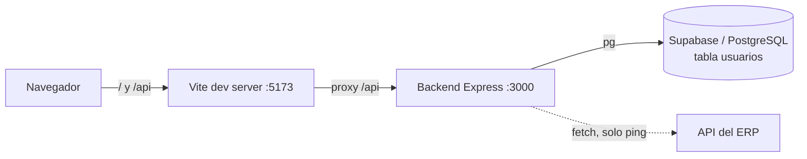
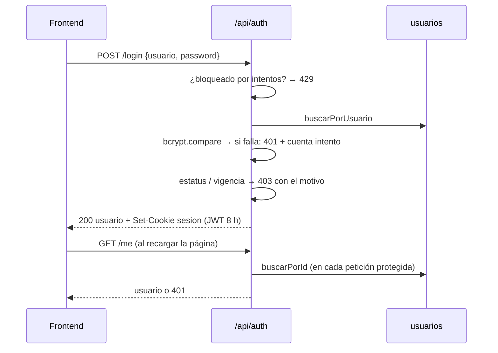

# Sistema Grupo Armas — Documentación técnica

> Estado al 14/10/2026. Dirigida al equipo técnico que continúe el desarrollo.

## 1. Resumen

Aplicación web interna para **consultar el inventario de piezas por planta y dar seguimiento a los traspasos de material entre plantas** de Grupo Armas (plantas 1, 2, 3 y 6).

| Área | Estado |
| --- | --- |
| Login, sesión y permisos | Implementado (backend + frontend) |
| Control de usuarios (CRUD) | Implementado sobre PostgreSQL / Supabase |
| Inventario, seguimiento entre plantas, historial | Solo interfaz, con **datos de ejemplo fijos** en el frontend |
| Integración con el ERP | Sin empezar: solo existe una ruta de prueba de conexión |
| Pruebas automatizadas | No hay |

## 2. Arquitectura



- En desarrollo, Vite reenvía `/api/*` a `http://localhost:3000` (`frontend/vite.config.ts`). Frontend y API quedan en el mismo origen, por eso **no se usa CORS** y la cookie de sesión funciona con `SameSite=Strict`.
- Si `DATABASE_URL` no está configurada, el backend usa un repositorio **en memoria** con usuarios de ejemplo (ver §4.3).

### Stack

| Capa | Tecnología |
| --- | --- |
| Frontend | React 19, TypeScript, Vite 8, React Compiler, `react-day-picker` + `date-fns` |
| Backend | Node 24, Express 5, TypeScript, `tsx` en desarrollo |
| Base de datos | PostgreSQL alojado en Supabase (`pg`) |
| Seguridad | `bcryptjs` (hash de contraseñas), `jsonwebtoken` (sesión), `cookie-parser` |

### Estructura de carpetas

```
ProyectoEstadias/
├── backend/
│   ├── sql/
│   │   ├── 01_usuarios.sql                    # esquema de la tabla usuarios
│   │   └── 02_migracion_local_a_supabase.sql  # usuarios migrados desde el PostgreSQL local
│   └── src/
│       ├── server.ts            # arranque, middlewares y montaje de rutas
│       ├── config/env.ts        # requiredEnv(): falla si falta una variable
│       ├── auth/
│       │   ├── session.ts       # JWT, opciones de cookie, regla de estatus/vigencia
│       │   ├── middleware.ts    # requireAuth, requireAdmin
│       │   └── loginAttempts.ts # bloqueo por intentos fallidos (memoria)
│       ├── db/
│       │   ├── usersRepository.ts          # tipos + interfaz UsersRepository
│       │   ├── postgresUsersRepository.ts  # implementación PostgreSQL
│       │   ├── memoryUsersRepository.ts    # implementación en memoria
│       │   ├── pool.ts                     # pool de conexiones pg
│       │   └── index.ts                    # elige la implementación según el .env
│       ├── routes/
│       │   ├── auth.ts          # /api/auth
│       │   └── users.ts         # /api/users
│       ├── validation/users.ts  # validación y normalización de usuarios
│       ├── services/erpApi.ts   # cliente mínimo del ERP (ping)
│       └── scripts/crearAdmin.ts
├── frontend/
│   └── src/
│       ├── App.tsx              # pantallas, navegación y datos de ejemplo
│       ├── api/                 # client.ts, auth.ts, users.ts
│       ├── components/users/UsersScreen.tsx
│       ├── components/filters/  # filtros por fecha y material
│       ├── hooks/useTableFilters.ts
│       ├── lib/dates.ts
│       └── types/user.ts
└── docs/DOCUMENTACION.md
```

## 3. Puesta en marcha

### Requisitos

- Node.js 24 o superior (probado con 24.14).
- Un proyecto de Supabase o un PostgreSQL local.

### Variables de entorno (`backend/.env`)

Copiar `backend/.env.example` a `backend/.env` y llenar:

| Variable | Obligatoria | Uso |
| --- | --- | --- |
| `PORT` | No (3000) | Puerto del backend. Si se cambia, ajustar el proxy de `vite.config.ts`. |
| `JWT_SECRET` | **Sí** | Firma de las sesiones. Sin ella el servidor no arranca. Generar con `node -e "console.log(require('crypto').randomBytes(48).toString('hex'))"`. Usar uno distinto por ambiente. |
| `DATABASE_URL` | Sí, para datos reales | Cadena de conexión. Vacía = base en memoria. |
| `PGHOST`, `PGPORT`, `PGUSER`, `PGPASSWORD`, `PGDATABASE` | No | Alternativa a `DATABASE_URL`; solo se leen si ésta está vacía. |
| `ERP_API_URL`, `ERP_DEVICE_ID` | Solo para `/erp/ping` | Datos de la API del ERP. |

En el frontend, `VITE_API_URL` es opcional (por defecto `/api`).

**Cadena de Supabase:** Dashboard → botón **Connect** → **Connection String** → método **Session pooler** (puerto 5432, funciona en redes IPv4). La contraseña es la de la **base de datos**, no la de la cuenta; se cambia en *Project Settings → Database → Reset database password*. Caracteres especiales en la contraseña deben ir codificados en URL (`@` → `%40`).

### Primera vez

```bash
# 1. Dependencias
cd backend && npm install
cd ../frontend && npm install

# 2. Esquema: ejecutar backend/sql/01_usuarios.sql en el SQL Editor de Supabase

# 3. Crear (o recuperar) un administrador
cd backend
npm run crear-admin -- USUARIO CONTRASEÑA
```

### Comandos

| Dónde | Comando | Qué hace |
| --- | --- | --- |
| backend | `npm run dev` | Servidor con recarga automática (`tsx watch`) |
| backend | `npm run build` / `npm start` | Compila a `dist/` y lo ejecuta |
| backend | `npm run crear-admin -- USUARIO CONTRASEÑA` | Crea un ADMINISTRADOR o convierte uno existente en admin activo con contraseña nueva |
| frontend | `npm run dev` | Vite en `http://localhost:5173` |
| frontend | `npm run build` | Chequeo de tipos + build de producción |
| frontend | `npm run lint` | ESLint |

Al arrancar el backend, la consola indica qué repositorio usa: `[usuarios] Usando PostgreSQL como repositorio.` o el aviso de base en memoria.

## 4. Base de datos

### 4.1 Tabla `usuarios`

Definida en `backend/sql/01_usuarios.sql`.

| Columna | Tipo | Reglas |
| --- | --- | --- |
| `id` | `SERIAL` | PK |
| `usuario` | `VARCHAR(30)` | `NOT NULL UNIQUE`. Se guarda en mayúsculas. |
| `password_hash` | `VARCHAR(100)` | Hash bcrypt (10 rondas). Nunca sale de la API. |
| `tipo_usuario` | `VARCHAR(20)` | `ADMINISTRADOR`, `CAPTURISTA` o `CONSULTA` |
| `vigencia_fini` | `DATE` | Inicio de vigencia; `NULL` = sin límite |
| `vigencia_fechafin` | `DATE` | Fin de vigencia; `NULL` = sin límite |
| `estatus` | `VARCHAR(10)` | `ACTIVO` (default) o `INACTIVO` |

### 4.2 Migración a Supabase

`backend/sql/02_migracion_local_a_supabase.sql` copió los usuarios `PRODUCCION` y `GROSAS` desde el PostgreSQL local, conservando sus hashes (siguen con la misma contraseña), y ajusta la secuencia de `id`.

### 4.3 Repositorios

Todo acceso a usuarios pasa por la interfaz `UsersRepository` (`listar`, `buscarPorId`, `buscarPorUsuario`, `crear`, `modificar`, `eliminar`, `existeUsuario`). `db/index.ts` elige la implementación:

- **PostgreSQL** si hay `DATABASE_URL` o `PGDATABASE`.
- **Memoria** si no. Trae 8 usuarios de ejemplo con contraseña `123456` (admin: `JONATHAN SARABIA`; `ACONTRERAS` está inactivo). Los cambios se pierden al reiniciar. Útil para desarrollar y probar sin tocar Supabase.

## 5. Autenticación y permisos

### Flujo



### Reglas

| Tema | Comportamiento |
| --- | --- |
| Sesión | JWT firmado con `JWT_SECRET`, payload solo con el `id`. Va en la cookie `sesion`: `HttpOnly`, `SameSite=Strict`, `Secure` cuando `NODE_ENV=production`, duración 8 h. |
| Revalidación | `requireAuth` vuelve a leer al usuario de la BD en cada petición: desactivarlo, cambiarle el tipo o vencer su vigencia aplica de inmediato. |
| Estatus y vigencia | No entra si está `INACTIVO` o si la fecha local del servidor está fuera de `[vigencia_fini, vigencia_fechafin]`. Fechas vacías = sin límite. |
| Mensajes de error | Credenciales incorrectas o usuario inexistente → siempre `USUARIO O CONTRASEÑA INCORRECTOS` (mismo tiempo de respuesta, para no revelar qué usuarios existen). Solo si la contraseña es correcta se informa `USUARIO INACTIVO` / `USUARIO FUERA DE VIGENCIA`. |
| Intentos fallidos | 5 fallos para la misma combinación usuario + IP → bloqueo de 5 min (HTTP 429). Se guarda en memoria: se reinicia con el servidor y no se comparte entre instancias. |
| Roles | Solo `ADMINISTRADOR` puede usar `/api/users` y ve el botón "Usuarios del sistema". `CAPTURISTA` y `CONSULTA` tienen hoy el mismo acceso al resto. |
| Auto-protección | Un admin no puede quitarse el rol, desactivarse, dejarse fuera de vigencia ni eliminarse a sí mismo. |

### Frontend

- Al cargar la app se llama `GET /api/auth/me`; si hay sesión válida se entra directo al menú.
- `api/client.ts` expone `setOnSessionExpired`: cualquier 401 fuera de `/auth/*` regresa al login con el aviso `SESIÓN EXPIRADA`.
- "Cerrar sesión" llama `POST /api/auth/logout` y limpia el estado aunque falle la red.

## 6. Referencia de la API

Todas las respuestas de error tienen la forma `{ "errores": ["MENSAJE", ...] }`. Las fechas viajan como `YYYY-MM-DD` o `null`.

### `/api/auth`

| Método | Ruta | Sesión | Cuerpo | Respuestas |
| --- | --- | --- | --- | --- |
| POST | `/login` | No | `{ usuario, password }` | 200 usuario + cookie · 400 faltan datos · 401 credenciales · 403 inactivo/vigencia · 429 bloqueado |
| POST | `/logout` | No | — | 204, borra la cookie |
| GET | `/me` | Sí | — | 200 usuario · 401 sin sesión |

### `/api/users` (requiere sesión de ADMINISTRADOR)

| Método | Ruta | Cuerpo | Respuestas |
| --- | --- | --- | --- |
| GET | `/` | — | 200 lista de usuarios (sin hash) |
| POST | `/` | usuario completo, `password` obligatoria | 201 · 400 validación · 409 usuario repetido |
| PUT | `/:id` | usuario completo; `password` vacía = conservar la actual | 200 · 400 · 404 · 409 |
| DELETE | `/:id` | — | 204 · 400 (incluye borrarse a sí mismo) · 404 |

Sin sesión → 401; con sesión de otro rol → 403.

Cuerpo de usuario:

```json
{
  "usuario": "LNAVA",
  "password": "secreto1",
  "tipoUsuario": "CAPTURISTA",
  "vigenciaFini": "2026-01-01",
  "vigenciaFechafin": null,
  "estatus": "ACTIVO"
}
```

Validaciones (`validation/users.ts`, replicadas en `UsersScreen.tsx`): usuario de 3 a 30 caracteres (se convierte a mayúsculas), contraseña de al menos 6, tipo y estatus dentro de sus opciones, fechas reales, y vigencia final ≥ inicial.

### Otras

| Método | Ruta | Nota |
| --- | --- | --- |
| GET | `/` | Texto de prueba |
| GET | `/erp/ping` | Prueba de conexión al ERP. **No requiere sesión.** |

## 7. Frontend

La navegación es por estado (`activeScreen` en `App.tsx`), sin router.

| Pantalla | Qué muestra | Datos |
| --- | --- | --- |
| Login | Usuario y contraseña | API real |
| Menú | Accesos a las pantallas y cerrar sesión | — |
| Inventario general | Existencias por pieza/SKU en plantas 1, 2, 3 y 6 + total | Ejemplo (`initialInventory`) |
| Seguimiento entre plantas | Movimientos de la planta elegida; columnas distintas por planta (fecha, material, lote, saldo, origen, destino, pieza resultante, cantidad) | Ejemplo (`PLANT_TABLES`) |
| Historial de traspasos | Todos los movimientos de todas las plantas | Ejemplo (derivado de `PLANT_TABLES`) |
| Usuarios del sistema (solo admin) | Alta, edición y baja de usuarios | API real |

Las tablas de inventario, seguimiento e historial usan `useTableFilters` + `FilterBar`: filtro por material y, donde hay fecha, por rango de fechas.

## 8. Integración con el ERP

El ERP será el **origen de los datos de inventario y traspasos**, pero todavía no se conocen sus endpoints, el formato de sus respuestas ni su autenticación.

Lo que existe hoy (`backend/src/services/erpApi.ts`):

- Se tienen `ERP_API_URL` y `ERP_DEVICE_ID`.
- `pingErp()` hace `GET {ERP_API_URL}/ciclosserviceproc.aspx?{ERP_DEVICE_ID}` con timeout de 10 s y regresa la respuesta como texto, porque se desconoce si es JSON, XML u HTML.
- Se expone en `GET /erp/ping`.

No está confirmado que la API sea el método definitivo: en el futuro los datos podrían obtenerse de otra forma.

Preguntas abiertas:

- [ ] ¿Qué endpoints exponen inventario, movimientos y catálogos (piezas, plantas, lotes)?
- [ ] ¿Qué formato devuelven y cómo se autentica (¿basta el device id?)?
- [ ] ¿Se mantendrá la API o se accederá a los datos por otro medio?
- [ ] Cuando un CAPTURISTA registre un traspaso, ¿se guarda en la BD propia o se escribe en el ERP?

## 9. Pendientes

- [ ] Integrar el ERP y reemplazar los datos de ejemplo de inventario, seguimiento e historial (§8).
- [ ] Definir dónde se registran los traspasos capturados.
- [ ] Definir qué distingue a `CAPTURISTA` de `CONSULTA`; hoy tienen el mismo acceso.
- [ ] Decidir si `GET /erp/ping` debe requerir sesión.
- [ ] Agregar pruebas automatizadas (backend y frontend).
- [ ] Definir el despliegue: con frontend y backend en orígenes distintos haría falta CORS y revisar `SameSite` de la cookie; con varias instancias del backend, el bloqueo por intentos debe moverse a un almacenamiento compartido.
- [ ] `crear-admin` recibe la contraseña como argumento, así que queda en el historial de la terminal; considerar pedirla de forma interactiva.
